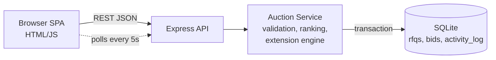

# British Auction RFQ System

## Run
```
npm install
npm start      # http://localhost:3000
```

## HLD

- **Frontend**: listing, create RFQ, details (ranking, bid form, config, countdown, activity log). Polls for updates.
- **API**: `POST/GET /api/rfqs`, `GET /api/rfqs/:id`, `POST /api/rfqs/:id/bids`.
- **Auction service**: each bid is one DB transaction: validate -> insert -> compare ranking before/after -> if inside trigger window and trigger matches, `new_close = min(close + Y, forced_close)` -> log.
- **Status** is derived from time (Upcoming / Active / Closed / Force Closed); server time is the source of truth.
- **Scaling path**: swap SQLite for Postgres (`SELECT ... FOR UPDATE` on the RFQ row), WebSockets instead of polling.

## Schema
See `schema.sql`: `rfqs` (config + current/forced close), `bids` (charges, total, transit, validity), `activity_log` (BID / EXTENSION with old/new close and reason).

## Rules implemented
- forced_close > bid_close (API + DB CHECK); extensions are capped at forced_close.
- Triggers: BID_RECEIVED, ANY_RANK_CHANGE, L1_CHANGE, all only inside last X minutes.
- A supplier's new bid must be lower than their own previous total; ranking uses each supplier's latest bid.
